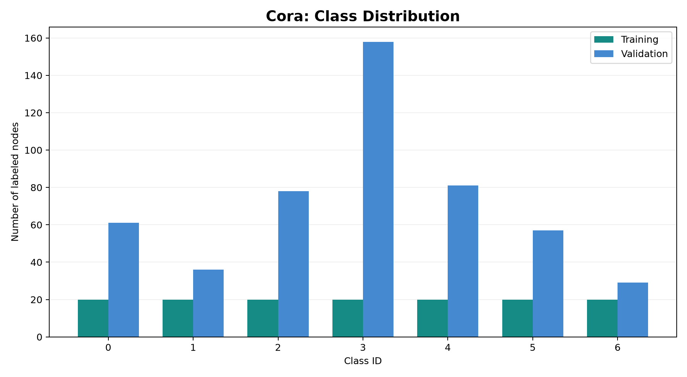
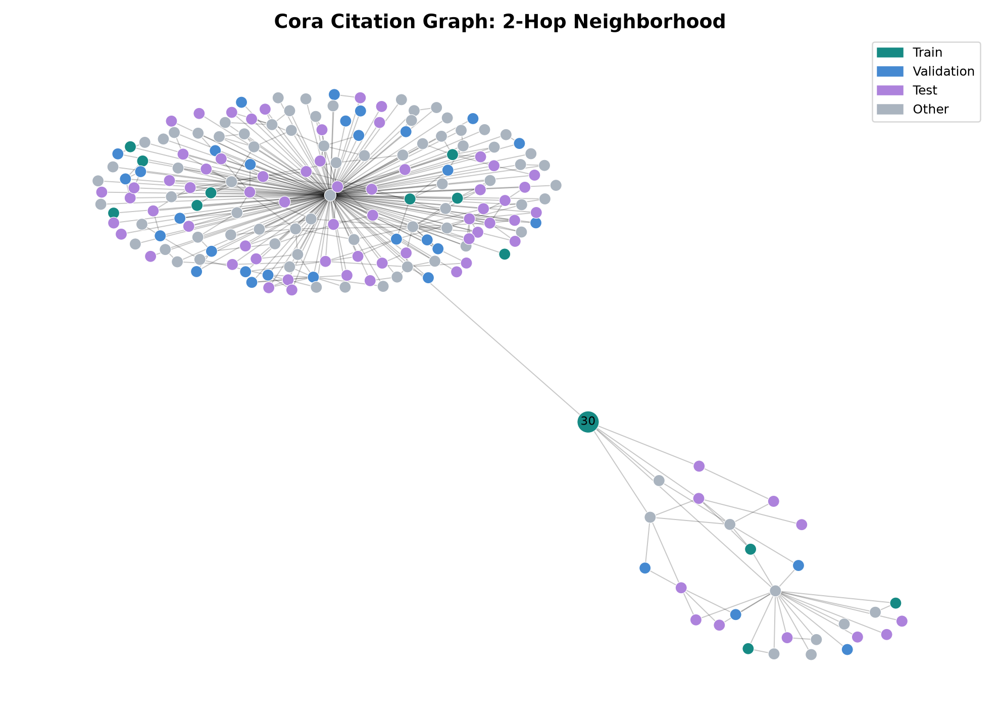
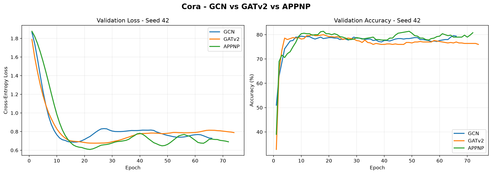
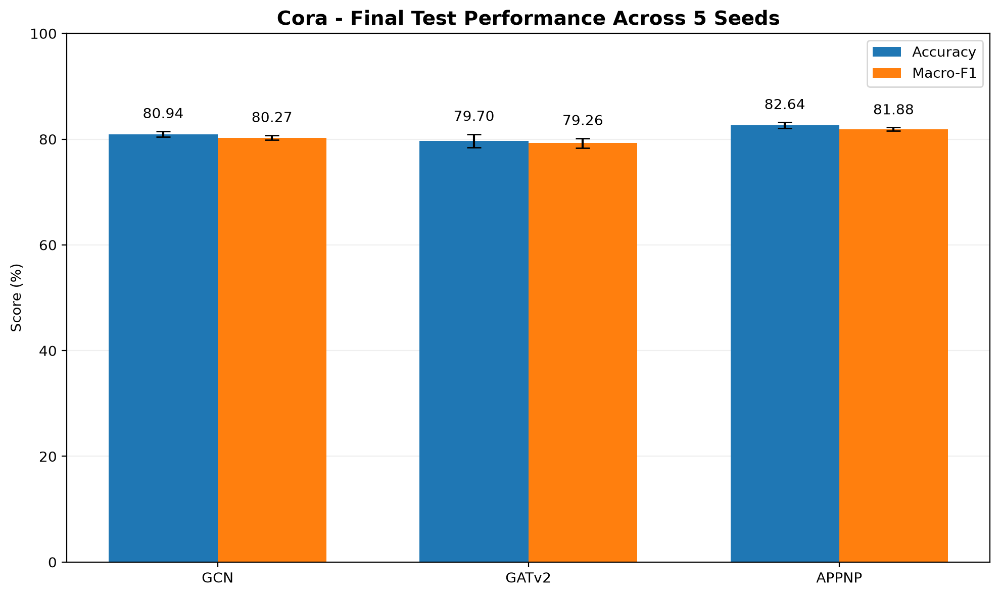
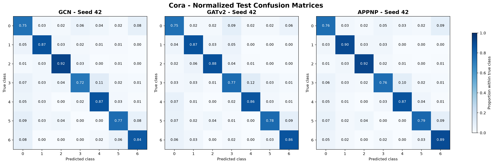

# Semi-Supervised Node Classification on Cora: GCN vs. GATv2 vs. APPNP

A comparative study of three Graph Neural Network (GNN) architectures for semi-supervised node classification on the Cora citation network.

This project implements and evaluates **Graph Convolutional Networks (GCN)**, **Graph Attention Networks v2 (GATv2)**, and **Approximate Personalized Propagation of Neural Predictions (APPNP)** using PyTorch and PyTorch Geometric.

The comparison includes five random seeds per architecture, early stopping, validation-based checkpoint selection, classification metrics, training visualizations, and confusion matrices.

## 1. Project Overview

Graph Neural Networks learn representations from both node features and graph connectivity.

In this project, each node represents a scientific publication, and edges describe citation relationships between publications. The objective is to classify publications into seven categories using a limited number of labeled training nodes.

The three architectures are evaluated under a common experimental protocol to investigate their classification performance and variability across random initializations.

### Research Objectives

- Implement GCN, GATv2, and APPNP for node classification.
- Train the models using the same public Cora data split.
- Compare validation accuracy and cross-entropy loss.
- Evaluate test accuracy and macro-F1 across five random seeds.
- Examine class-specific errors through confusion matrices.
- Analyze the variability of results across initializations.

## 2. Dataset

The project uses the **Cora citation dataset**, loaded through the Planetoid dataset interface in PyTorch Geometric.

| Property | Value |
|---|---:|
| Graphs | 1 |
| Nodes | 2,708 |
| Recorded directed edge entries | 10,556 |
| Node features | 1,433 |
| Node classes | 7 |
| Training nodes | 140 |
| Validation nodes | 500 |
| Test nodes | 1,000 |

The citation graph is represented as an undirected graph in PyTorch Geometric, with both edge directions recorded.

### Semi-Supervised Learning

Only 140 labeled nodes are used to calculate the training loss, corresponding to 20 training nodes per class.

The 500 validation nodes are used for monitoring training and selecting checkpoints.

The 1,000 test nodes are reserved for final evaluation.

This is a **transductive node classification** experiment: node features and graph connectivity are available across the full graph during message passing, while training uses labels only from the training mask.

### Class Distribution



### Citation Graph Visualization

The following figure illustrates a two-hop neighborhood extracted from the citation network.



## 3. Model Architectures

### 3.1 Graph Convolutional Network (GCN)

GCN aggregates information from neighboring nodes using graph convolution operations.

The implemented architecture contains:

- Two GCN convolution layers.
- 64 hidden features.
- ReLU activation.
- Dropout regularization.
- A final output of seven class logits.

Implementation: `src/gcn_model.py`

### 3.2 Graph Attention Network v2 (GATv2)

GATv2 uses learnable attention mechanisms to assign different importance to neighboring nodes based on their features.

The implemented architecture contains:

- Two GATv2 convolution layers.
- Eight attention heads in the first layer.
- Eight output features per head, producing 64 hidden features.
- ELU activation.
- A single-head output layer for seven classes.
- Feature and attention dropout.

Implementation: `src/gatv2_model.py`

### 3.3 Approximate Personalized Propagation of Neural Predictions (APPNP)

APPNP separates feature-based prediction from propagation across the graph.

First, a multilayer perceptron produces initial class logits. Then, APPNP propagates these predictions using an approximate personalized PageRank mechanism.

The implemented architecture contains:

- A two-layer MLP.
- 64 hidden features.
- ReLU activation.
- Dropout regularization.
- 10 propagation steps.
- Teleportation coefficient alpha = 0.1.
- Propagation dropout = 0.0.

Implementation: `src/appnp_model.py`

## 4. Experimental Setup

All experiments use the same public Cora split.

| Parameter | Configuration |
|---|---|
| Framework | PyTorch + PyTorch Geometric |
| Device | CPU |
| Hidden features | 64 |
| Dropout | 0.5 |
| Optimizer | Adam |
| Learning rate | 0.01 |
| Weight decay | 0.0005 |
| Maximum epochs | 300 |
| Early stopping patience | 50 |
| Checkpoint selection | Minimum validation loss |
| Random seeds | 7, 21, 42, 123, 2024 |

The same optimization settings are used for the three architectures, while their architectural mechanisms and parameter counts differ.

### Training Procedure

For each random seed:

1. Initialize the model.
2. Compute the loss using training labels only.
3. Update model parameters through backpropagation.
4. Evaluate cross-entropy loss and accuracy on the validation nodes.
5. Save the checkpoint with the lowest validation loss.
6. Stop training if validation loss does not improve for 50 consecutive epochs.

The final test labels are not used for parameter optimization, early stopping, or checkpoint selection.

## 5. Validation Results

Five random seeds were evaluated per architecture.

The following results report the mean validation accuracy and sample standard deviation across the five selected checkpoints.

| Model | Mean Validation Accuracy | Standard Deviation |
|---|---:|---:|
| GCN | 78.76% | 0.52 percentage points |
| GATv2 | 77.52% | 1.68 percentage points |
| APPNP | 80.60% | 0.40 percentage points |

APPNP achieved the highest mean validation accuracy in this experiment. GATv2 showed the largest variation across the five seeds.

These observations refer specifically to the implemented model configurations and the selected Cora data split.

### Training Curves



The training curves show validation cross-entropy loss and accuracy for seed 42.

## 6. Final Test Results

After model selection and training were completed, the 15 saved checkpoints were evaluated on the same 1,000 test nodes.

The reported values are the mean and sample standard deviation across five seeds.

| Model | Test Accuracy | Test Macro-F1 |
|---|---:|---:|
| GCN | 80.94% ± 0.54 pp | 80.27% ± 0.46 pp |
| GATv2 | 79.70% ± 1.25 pp | 79.26% ± 0.91 pp |
| APPNP | 82.64% ± 0.55 pp | 81.88% ± 0.32 pp |

Here, `pp` denotes percentage points.

### Interpretation

Under the experimental conditions used in this project:

- APPNP obtained the highest mean test accuracy and macro-F1.
- GCN obtained higher mean test accuracy than GATv2.
- GATv2 exhibited greater variation across the five seeds than the other architectures.

These findings are specific to the evaluated Cora split, model configurations, and training protocol. They do not establish a universal ordering of these architectures.

### Final Performance Visualization



The error bars represent the sample standard deviation across the five random seeds.

## 7. Confusion Matrix Analysis

Normalized confusion matrices were generated for the three checkpoints trained with seed 42.

| Model | Correct Test Predictions | Test Accuracy |
|---|---:|---:|
| GCN | 802 / 1,000 | 80.20% |
| GATv2 | 812 / 1,000 | 81.20% |
| APPNP | 824 / 1,000 | 82.40% |



The matrices are normalized by true class to illustrate the proportion of correctly and incorrectly classified nodes within each category.

Seed 42 is used as an illustrative example. The primary quantitative results are the five-seed averages.

## 8. Project Structure

```text
cora-gnn-comparison/
├── src/
│   ├── explore_cora.py
│   ├── visualize_cora.py
│   ├── gcn_model.py
│   ├── gatv2_model.py
│   ├── appnp_model.py
│   ├── train_gcn.py
│   ├── train_gatv2.py
│   ├── train_appnp.py
│   ├── train_multiple_seeds.py
│   ├── final_test_evaluation.py
│   ├── plot_confusion_matrices.py
│   └── plot_model_comparison.py
├── data/
│   └── Planetoid/
├── models/
├── outputs/
│   ├── figures/
│   └── metrics/
├── reports/
└── README.md
```

The `data/` and `models/` directories are local storage locations for the downloaded dataset and trained checkpoints.

## 9. Installation

### Requirements

- Python 3.12
- PyTorch
- PyTorch Geometric
- NumPy
- Pandas
- Scikit-learn
- Matplotlib
- NetworkX

### Clone the Repository

Once the project is published on GitHub:

```bash
git clone <REPOSITORY_URL>
cd cora-gnn-comparison
```

Replace `<REPOSITORY_URL>` with the URL of the published repository.

### Create a Virtual Environment

```bash
python3 -m venv .venv
source .venv/bin/activate
```

### Install Dependencies

For a CPU-only environment:

```bash
python -m pip install --upgrade pip
python -m pip install torch --index-url https://download.pytorch.org/whl/cpu
python -m pip install torch_geometric numpy pandas scikit-learn matplotlib networkx
```

For exact reproducibility, use the dependency versions documented for the released project.

## 10. Running the Experiments

All commands below should be executed from the project root.

### Step 1 — Explore Cora

```bash
python src/explore_cora.py
```

The Planetoid loader downloads and prepares the Cora dataset if it is not already available locally.

### Step 2 — Generate Dataset Visualizations

```bash
python src/visualize_cora.py
```

### Step 3 — Train the Three Architectures with Seed 42

```bash
python src/train_gcn.py
python src/train_gatv2.py
python src/train_appnp.py
```

The scripts save checkpoints and training histories in `models/` and `outputs/metrics/`.

### Step 4 — Run Additional Seeds

```bash
python src/train_multiple_seeds.py
```

This script reuses the seed-42 checkpoints and runs the additional seeds: 7, 21, 123, and 2024.

Its validation summary is saved in:

```text
outputs/metrics/multiseed_validation_summary.csv
```

### Step 5 — Run Final Evaluation

```bash
python src/final_test_evaluation.py
```

This step loads the 15 saved checkpoints and evaluates their accuracy and macro-F1.

Results are saved in:

```text
outputs/metrics/final_test_all_seeds.csv
outputs/metrics/final_test_summary.csv
```

The test set should not be used to tune the architectures or choose hyperparameters.

### Step 6 — Generate Final Figures

```bash
python src/plot_confusion_matrices.py
python src/plot_model_comparison.py
```

## 11. Technologies

- Python
- PyTorch
- PyTorch Geometric
- NumPy
- Pandas
- Scikit-learn
- Matplotlib
- NetworkX
- Ubuntu / WSL
- Git and GitHub

## 12. Limitations

The experiments use a single citation graph and the standard public Cora split.

Although five random seeds were evaluated, the data split remains fixed, and the seed-level standard deviations do not capture uncertainty across other datasets or train/test splits.

The three architectures have different parameter counts and computational characteristics. Using identical optimizer settings does not necessarily provide individually optimized configurations for all architectures.

The results should therefore be understood as a comparison of these specific implementations and experimental settings.

Future studies could investigate additional graph datasets, different public or randomized splits, hyperparameter selection using validation data, and controlled computational benchmarks.

Any newly tuned models should be evaluated on an untouched test set.

## 13. Conclusion

This project provides an end-to-end comparison of three Graph Neural Network architectures for semi-supervised node classification.

Using five random seeds on the public Cora split, APPNP achieved a mean test accuracy of **82.64%** and a mean macro-F1 of **81.88%**. GCN achieved 80.94% mean test accuracy, while GATv2 achieved 79.70%.

The experiments illustrate how graph convolution, attention-based aggregation, and personalized prediction propagation behave under a shared training protocol.

The project demonstrates practical experience in graph learning, PyTorch Geometric, reproducible experimentation, performance evaluation, and model comparison.
