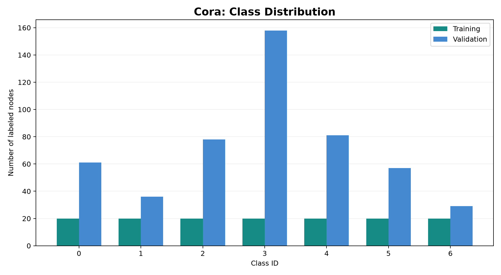
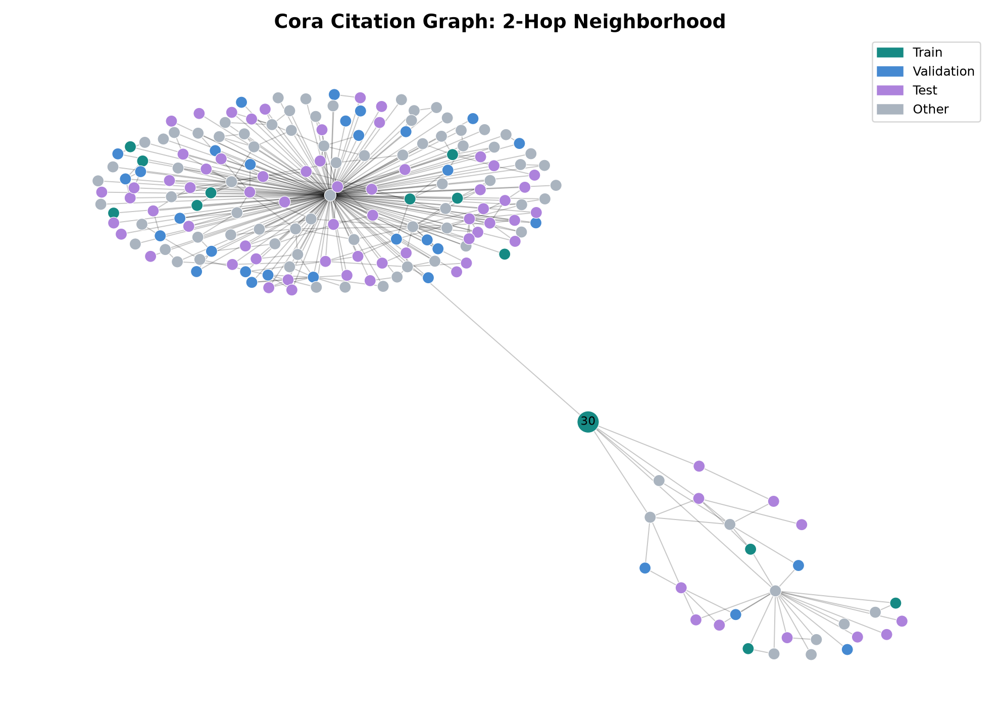
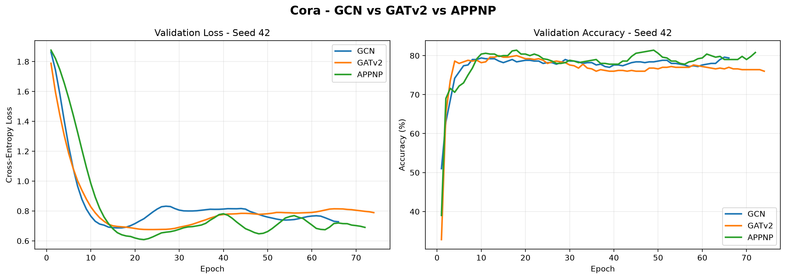
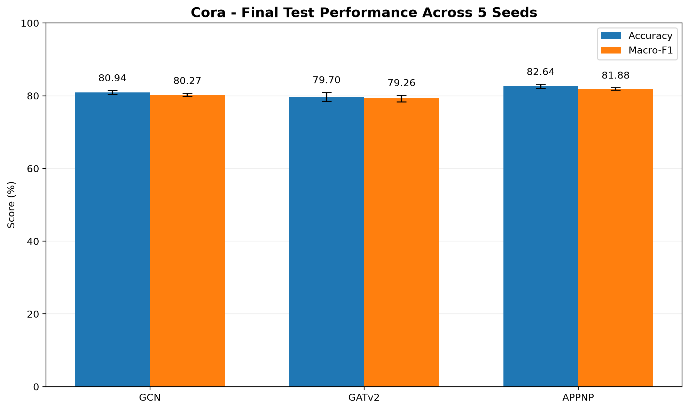
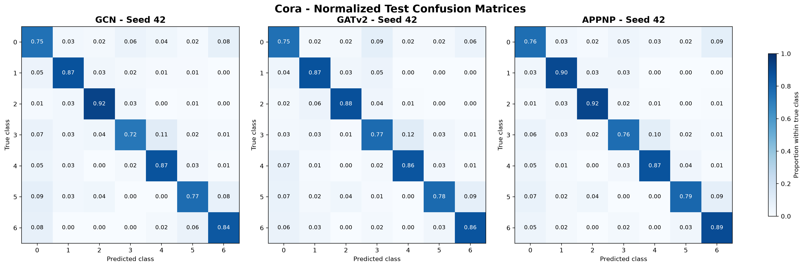

# Technical Report
## Semi-Supervised Node Classification on Cora: GCN vs. GATv2 vs. APPNP

### Abstract

This project investigates semi-supervised node classification using three Graph Neural Network (GNN) architectures: Graph Convolutional Networks (GCN), Graph Attention Networks v2 (GATv2), and Approximate Personalized Propagation of Neural Predictions (APPNP).

All three architectures were implemented in PyTorch Geometric and evaluated on the standard public split of the Cora citation dataset.

Five independent random initializations were evaluated for each architecture, producing 15 trained models. Model checkpoints were selected using validation cross-entropy loss, while test accuracy and macro-F1 were reserved for final evaluation.

APPNP achieved a mean test accuracy of 82.64%, compared with 80.94% for GCN and 79.70% for GATv2. These results describe the specific architectures and training configurations evaluated in this study.

---

## 1. Introduction

Graph Neural Networks are designed to learn from graph-structured data, where observations are represented as nodes and relationships as edges.

Unlike conventional neural networks operating on independent samples, GNNs can aggregate information from connected nodes.

The Cora citation network provides a benchmark for studying this type of learning. Each node represents a scientific publication, and edges represent citation relationships.

The objective is to predict the scientific category of each publication using a limited number of labeled nodes.

This study compares three approaches to learning on graphs:

- GCN: graph convolution and normalized neighborhood aggregation.
- GATv2: feature-dependent attention over neighboring nodes.
- APPNP: neural predictions followed by personalized propagation.

The comparison focuses on predictive performance and variability across random initializations.

---

## 2. Dataset and Problem Formulation

### 2.1 Cora Dataset

The experiment uses the Planetoid Cora dataset, loaded with PyTorch Geometric.

| Property | Value |
|---|---:|
| Number of nodes | 2,708 |
| Recorded edge entries | 10,556 |
| Features per node | 1,433 |
| Number of classes | 7 |
| Training nodes | 140 |
| Validation nodes | 500 |
| Test nodes | 1,000 |

The dataset contains an undirected citation graph represented with both edge directions.

Node features describe publications, while node labels correspond to seven scientific categories.

### 2.2 Semi-Supervised Classification

Let:

- G = (V, E) denote the citation graph.
- X denote the node feature matrix.
- Y denote the node labels.
- V_train denote the labeled training nodes.

The objective is to learn a function that predicts a class label for each node using its features and the graph structure.

Only the 140 training labels contribute to the training loss.

The public dataset masks contain:

- 140 labeled training nodes.
- 500 validation nodes.
- 1,000 test nodes.

The remaining nodes are not directly used for supervised loss or evaluation.

The experiment follows a transductive learning setting. Features and graph connections of unlabeled nodes remain available during message passing.

The training, validation, and test masks are disjoint.

### 2.3 Dataset Visualization

---

## 3. Graph Neural Network Architectures

### 3.1 Graph Convolutional Network

Graph Convolutional Networks aggregate information from neighboring nodes using normalized graph connectivity.

A graph convolution can be expressed as:

H^(l+1) = sigma(D^(-1/2) A_tilde D^(-1/2) H^(l) W^(l))

where:

- A_tilde is the adjacency matrix including self-loops.
- D is the degree matrix of A_tilde.
- H^(l) represents the node embeddings at layer l.
- W^(l) denotes trainable weights.
- sigma is the activation function.

The implemented GCN contains two graph convolution layers:

Input(1433) -> GCN(64) -> ReLU -> GCN(7)

Dropout is applied to input features and hidden representations.

The model contains 92,231 trainable parameters.

### 3.2 Graph Attention Network v2

GATv2 introduces learnable attention coefficients between connected nodes.

Instead of relying only on fixed graph normalization, attention is used to determine how much neighboring representations contribute to a node's updated embedding.

A GATv2 attention score is computed using a learnable transformation of the source and destination node features, followed by a nonlinear activation and an attention vector.

Attention scores are normalized over each node's neighborhood using softmax.

The implemented architecture contains:

- First GATv2 layer: eight attention heads.
- Eight hidden features per attention head.
- Total hidden representation: 64 features.
- ELU activation.
- Second GATv2 layer: one attention head.
- Seven output logits.
- Feature and attention dropout.

The model contains 184,604 trainable parameters.

### 3.3 Approximate Personalized Propagation of Neural Predictions

APPNP separates the neural prediction network from graph propagation.

A multilayer perceptron first produces initial predictions:

Z = MLP(X)

These predictions are subsequently propagated using an approximation of personalized PageRank.

The propagation process can be written as:

H^(k+1) = (1 - alpha) A_hat H^(k) + alpha Z

where:

- Z denotes the initial neural predictions.
- A_hat denotes the normalized graph adjacency matrix.
- alpha controls the contribution of the initial predictions.
- k is the propagation iteration.

The implementation uses:

- A two-layer MLP.
- 64 hidden features.
- ReLU activation.
- Dropout probability of 0.5.
- 10 propagation iterations.
- Teleportation coefficient alpha = 0.1.
- Propagation dropout of 0.0.

The APPNP model contains 92,231 trainable parameters.

---

## 4. Experimental Methodology

### 4.1 Common Training Configuration

| Hyperparameter | Value |
|---|---|
| Optimizer | Adam |
| Learning rate | 0.01 |
| Weight decay | 0.0005 |
| Hidden dimensions | 64 |
| Feature dropout | 0.5 |
| Maximum epochs | 300 |
| Early stopping patience | 50 |
| Checkpoint selection | Minimum validation loss |
| Device | CPU |
| Random seeds | 7, 21, 42, 123, 2024 |

The same optimizer settings were used across models. Architecture-specific components, including attention and propagation, differed.

### 4.2 Training Objective

Training uses categorical cross-entropy loss computed exclusively on nodes belonging to the training mask.

For each training iteration:

1. Perform a forward pass using the full graph.
2. Select the predictions corresponding to training nodes.
3. Compute cross-entropy using training labels.
4. Backpropagate the training loss.
5. Update model parameters using Adam.
6. Evaluate validation loss and validation accuracy.

The test labels do not contribute to model training or checkpoint selection.

### 4.3 Early Stopping

Each experiment runs for at most 300 epochs.

Whenever validation loss improves by more than 0.000001, the corresponding checkpoint is saved.

Training stops after 50 consecutive epochs without sufficient validation loss improvement.

The saved checkpoint is selected by minimum validation loss, not by maximum validation accuracy.

### 4.4 Multiple Random Seeds

The training procedure was repeated for five seeds:

7, 21, 42, 123, and 2024.

For every architecture, five checkpoints were selected independently on validation data.

This protocol provides a measure of variability related to model initialization and training randomness.

It does not capture variability across different dataset splits or citation graphs.

---

## 5. Validation Results

### 5.1 Validation Accuracy Across Five Seeds

| Model | Mean Accuracy | Sample Standard Deviation |
|---|---:|---:|
| GCN | 78.76% | 0.52 percentage points |
| GATv2 | 77.52% | 1.68 percentage points |
| APPNP | 80.60% | 0.40 percentage points |

APPNP achieved the highest average validation accuracy under the evaluated configurations.

GATv2 showed greater variation across random initializations.

These are validation measurements, not test results.

### 5.2 Training Curves

The figure presents validation loss and accuracy during the seed-42 training runs.

For all three architectures, high accuracy was reached on the limited set of labeled training nodes.

The gap between training and validation performance indicates that generalization should be monitored carefully.

---

## 6. Final Test Evaluation

### 6.1 Evaluation Protocol

After training and checkpoint selection were completed, each of the 15 selected checkpoints was evaluated on the same 1,000 test nodes.

Two metrics were computed:

**Accuracy**

The proportion of correctly classified test nodes.

**Macro-F1**

The unweighted mean of the per-class F1 scores across all seven classes.

Macro-F1 gives equal importance to the classes when aggregating class-level performance.

No checkpoint was selected or modified using test results.

### 6.2 Final Test Results

| Model | Accuracy Mean ± Std | Macro-F1 Mean ± Std |
|---|---:|---:|
| GCN | 80.94% ± 0.54 pp | 80.27% ± 0.46 pp |
| GATv2 | 79.70% ± 1.25 pp | 79.26% ± 0.91 pp |
| APPNP | 82.64% ± 0.55 pp | 81.88% ± 0.32 pp |

Here, pp means percentage points. Standard deviations are calculated across the five seeds.

APPNP obtained the highest mean test accuracy and macro-F1 under the tested configuration.

GATv2 exhibited a larger test accuracy standard deviation across the five seeds.

These comparisons are descriptive. Statistical significance was not established by this experiment.

### 6.3 Final Test Visualization

The bars represent the mean test scores, while error bars represent standard deviations across random seeds.

---

## 7. Confusion Matrix Analysis

Normalized confusion matrices were generated for the seed-42 checkpoint of each model.

| Model | Correct Predictions | Test Accuracy |
|---|---:|---:|
| GCN | 802 / 1,000 | 80.20% |
| GATv2 | 812 / 1,000 | 81.20% |
| APPNP | 824 / 1,000 | 82.40% |

Each row is normalized by the number of test examples belonging to the corresponding true class.

The diagonal elements show the proportion correctly classified within each category, while off-diagonal elements indicate classification errors.

These matrices illustrate the seed-42 predictions. The primary quantitative comparison is based on all five seeds.

---

## 8. Discussion

The experimental results reveal differences between the evaluated architectures.

**GCN:** The convolution-based architecture produced mean test accuracy of 80.94% with relatively low variation across the five seeds.

**GATv2:** The attention-based architecture achieved mean test accuracy of 79.70% and showed greater sensitivity to random initialization in this experiment.

**APPNP:** The prediction-propagation architecture achieved mean test accuracy of 82.64% and mean macro-F1 of 81.88%.

The outcomes indicate that adding an attention mechanism does not automatically improve predictive performance for every dataset and configuration.

Similarly, a deeper propagation mechanism does not necessarily require a larger trainable parameter count.

However, these findings should not be generalized beyond the studied setting without further experimentation.

---

## 9. Limitations

This study has several limitations.

**Single graph:** Only the Cora citation network was evaluated.

**Fixed data split:** All five seeds used the same public train, validation, and test masks.

**Limited training labels:** Only 140 labeled nodes were available for supervised optimization.

**Different model capacities:** GATv2 contains more trainable parameters than GCN and APPNP.

**Common hyperparameters:** Using the same learning rate, weight decay, and dropout settings does not guarantee that each architecture operates at its individually optimized configuration.

**Limited uncertainty characterization:** Variation across random seeds does not measure uncertainty due to different datasets or graph splits.

**No controlled runtime benchmark:** Training times were observed locally, but computation and inference costs were not systematically benchmarked.

**Transductive evaluation:** The study does not establish performance on entirely new, unseen graphs.

---

## 10. Future Work

Potential extensions include:

- Evaluating additional citation networks, including CiteSeer and PubMed.
- Investigating different train/validation/test splits.
- Comparing different labeled-node budgets.
- Studying graph depth and over-smoothing.
- Evaluating attention-head configurations.
- Examining APPNP propagation depth and teleportation coefficients.
- Measuring inference time, training cost, and memory consumption.
- Assessing performance on inductive graph-learning tasks.

Any newly tuned architectures should be evaluated using a new, untouched test protocol.

---

## 11. Conclusion

This study implemented and evaluated three Graph Neural Network architectures for semi-supervised node classification on the Cora citation graph.

Fifteen models were trained using five random seeds per architecture.

Under the chosen configurations, the final test results were:

- GCN: 80.94% mean accuracy.
- GATv2: 79.70% mean accuracy.
- APPNP: 82.64% mean accuracy.

APPNP also achieved the highest mean macro-F1 in these experiments, at 81.88%.

The project demonstrates an end-to-end experimental workflow involving graph representation learning, neural model implementation, validation-based checkpoint selection, multiple random initializations, performance evaluation, and scientific reporting.

The reported conclusions are limited to the evaluated Cora graph, public split, and experimental settings.
